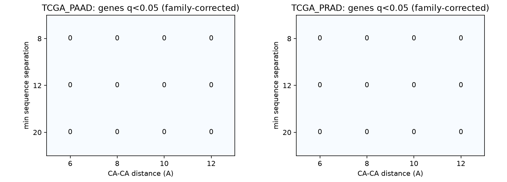

# Results (auto-generated from real cohort outputs)

Primary endpoint (pre-specified v1.1): driver vs not-listed difference in the decoy-calibrated PTM-specific score,
tested with a mutation-burden x PTM-anchor stratified permutation test. Reported first, including when null.

## 1. Primary result per cohort

| cohort | genes tested | drivers | not-listed | driver median decoy-z | not-listed median decoy-z | stratified one-sided p |
|---|---|---|---|---|---|---|
| TCGA_PAAD | 98 | 48 | 43 | 0 | 0 | 0.7958 (ok) |
| TCGA_PRAD | 99 | 49 | 43 | 0 | 0 | 0.5548 (ok) |

## 2. Secondary tests

| cohort | burden-stratified raw-score p | v1.0 Mann-Whitney p | Cliff's delta | driver hits q<0.05 | not-listed hits q<0.05 |
|---|---|---|---|---|---|
| TCGA_PAAD | 0.6293 | 0.2914 | 0.03846 | 0 | 0 |
| TCGA_PRAD | 0.2641 | 0.01156 | 0.1706 | 0 | 0 |

## 3. Replication

Cohorts must be independent (sample overlap checked outside this tool). Replication is claimed only if the primary
result is significant in the discovery cohort AND the same-direction one-sided p is < 0.05 in the second: p-values = ['0.7958', '0.5548'].

## 4. Threshold sensitivity (descriptive; family-corrected hits shown)

   cohort  sequence_separation_min  distance_max_A  is_primary_setting  genes_in_panel  genes_tested  genes_q_lt_005_per_setting  genes_q_lt_005_family_corrected  median_fold_enrichment                           result_file
TCGA_PAAD                        8             6.0               False             200            98                           0                                0                     0.0   TCGA_PAAD_robustness_sep8_dist6.tsv
TCGA_PAAD                        8             8.0               False             200            98                           0                                0                     0.0   TCGA_PAAD_robustness_sep8_dist8.tsv
TCGA_PAAD                        8            10.0                True             200            98                           0                                0                     0.0  TCGA_PAAD_robustness_sep8_dist10.tsv
TCGA_PAAD                        8            12.0               False             200            98                           0                                0                     0.0  TCGA_PAAD_robustness_sep8_dist12.tsv
TCGA_PAAD                       12             6.0               False             200            98                           0                                0                     0.0  TCGA_PAAD_robustness_sep12_dist6.tsv
TCGA_PAAD                       12             8.0               False             200            98                           0                                0                     0.0  TCGA_PAAD_robustness_sep12_dist8.tsv
TCGA_PAAD                       12            10.0               False             200            98                           0                                0                     0.0 TCGA_PAAD_robustness_sep12_dist10.tsv
TCGA_PAAD                       12            12.0               False             200            98                           0                                0                     0.0 TCGA_PAAD_robustness_sep12_dist12.tsv
TCGA_PAAD                       20             6.0               False             200            98                           0                                0                     0.0  TCGA_PAAD_robustness_sep20_dist6.tsv
TCGA_PAAD                       20             8.0               False             200            98                           0                                0                     0.0  TCGA_PAAD_robustness_sep20_dist8.tsv
TCGA_PAAD                       20            10.0               False             200            98                           0                                0                     0.0 TCGA_PAAD_robustness_sep20_dist10.tsv
TCGA_PAAD                       20            12.0               False             200            98                           0                                0                     0.0 TCGA_PAAD_robustness_sep20_dist12.tsv
TCGA_PRAD                        8             6.0               False             200            99                           0                                0                     0.0   TCGA_PRAD_robustness_sep8_dist6.tsv
TCGA_PRAD                        8             8.0               False             200            99                           0                                0                     0.0   TCGA_PRAD_robustness_sep8_dist8.tsv
TCGA_PRAD                        8            10.0                True             200            99                           0                                0                     0.0  TCGA_PRAD_robustness_sep8_dist10.tsv
TCGA_PRAD                        8            12.0               False             200            99                           0                                0                     0.0  TCGA_PRAD_robustness_sep8_dist12.tsv
TCGA_PRAD                       12             6.0               False             200            99                           0                                0                     0.0  TCGA_PRAD_robustness_sep12_dist6.tsv
TCGA_PRAD                       12             8.0               False             200            99                           0                                0                     0.0  TCGA_PRAD_robustness_sep12_dist8.tsv
TCGA_PRAD                       12            10.0               False             200            99                           0                                0                     0.0 TCGA_PRAD_robustness_sep12_dist10.tsv
TCGA_PRAD                       12            12.0               False             200            99                           0                                0                     0.0 TCGA_PRAD_robustness_sep12_dist12.tsv
TCGA_PRAD                       20             6.0               False             200            99                           0                                0                     0.0  TCGA_PRAD_robustness_sep20_dist6.tsv
TCGA_PRAD                       20             8.0               False             200            99                           0                                0                     0.0  TCGA_PRAD_robustness_sep20_dist8.tsv
TCGA_PRAD                       20            10.0               False             200            99                           0                                0                     0.0 TCGA_PRAD_robustness_sep20_dist10.tsv
TCGA_PRAD                       20            12.0               False             200            99                           0                                0                     0.0 TCGA_PRAD_robustness_sep20_dist12.tsv

## 5. Limits that apply to every number above

- This empirical null conditions on gene-specific coding missense opportunities and observed SBS96 counts; it is not a fitted COSMIC signature mixture and does not model regional replication timing or gene-specific callable coverage.
- Distance is CA-CA only (AlphaFold CA coordinates); side-chain/functional-group distances are not modelled.
- Decoy anchors control for PTM specificity within a gene (same amino acid, same anchor count) but not for unmeasured regional mutation-rate variation.
- Only single-nucleotide missense variants are included; indels and multi-nucleotide variants are excluded.
- A gene with missing structure positions, transcript mapping gaps, or unavailable context opportunities is untestable/partial, not negative.
- IntOGen absence means not listed in the selected release, not a validated biological non-driver label.
- AlphaFold structures are predictions; use experimental structures if available and suitable, and report mapping QC.
